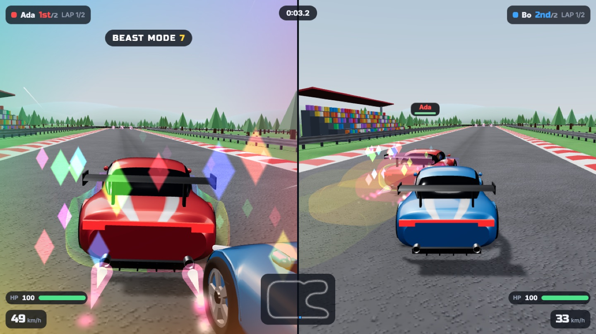
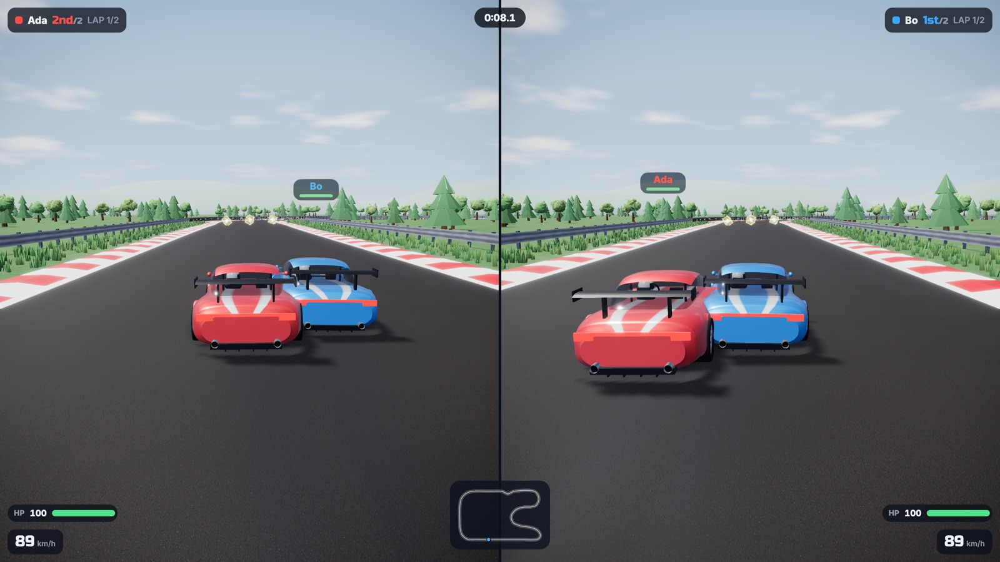
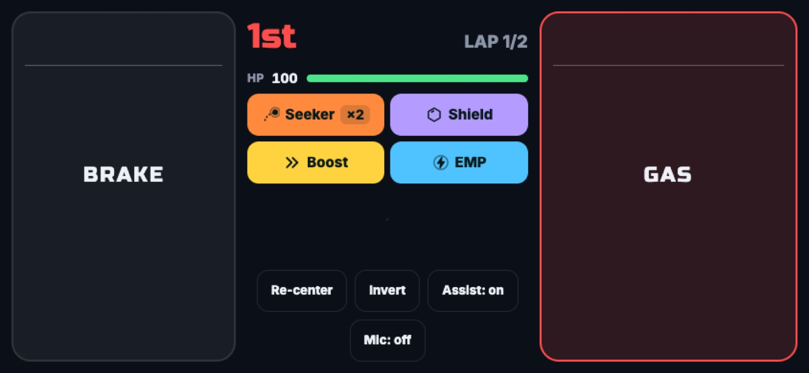
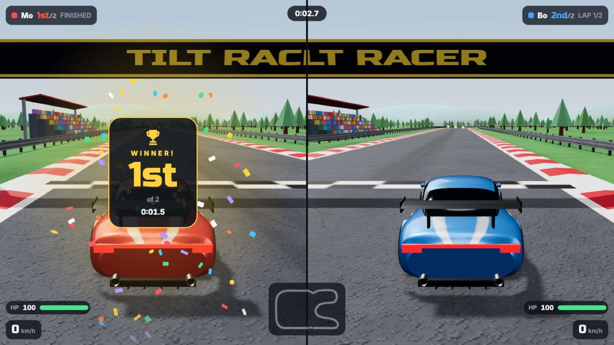
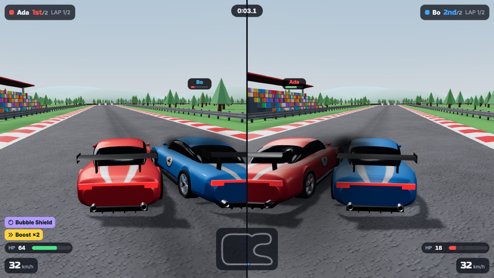
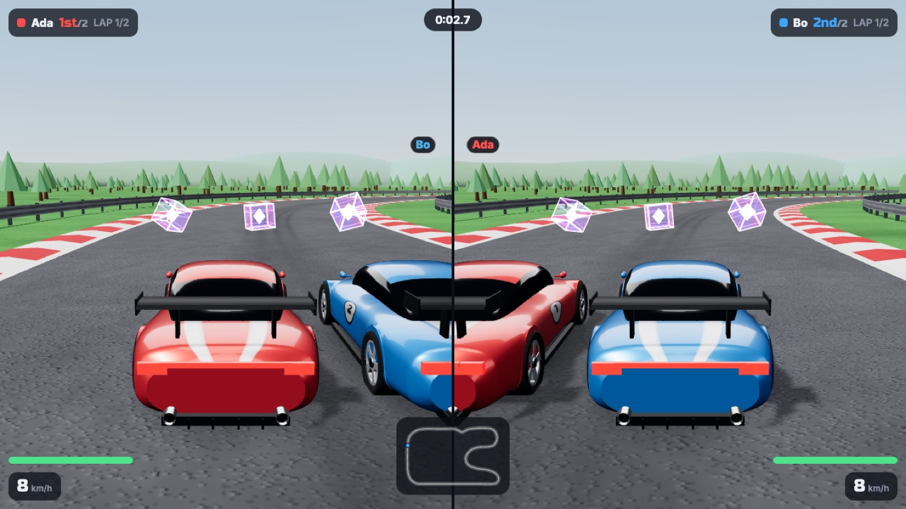
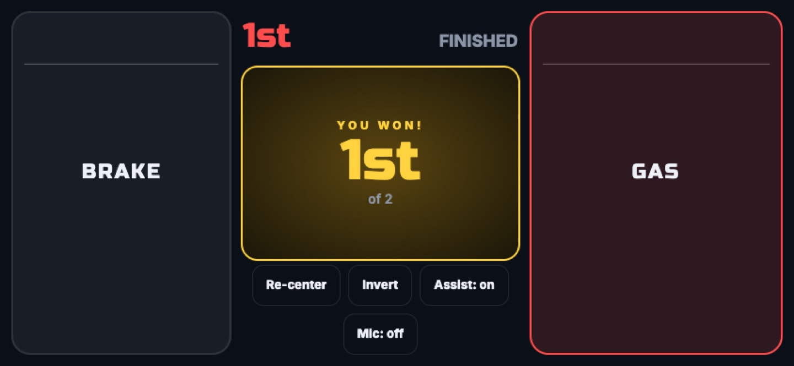
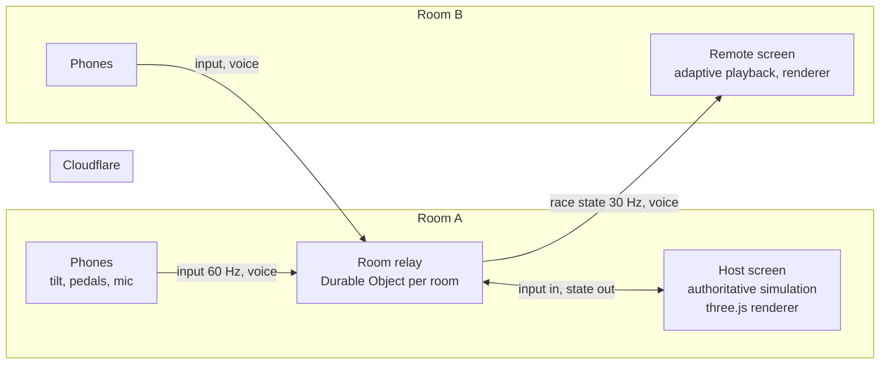

# Tilt Racer

**A 3D party racing game where your phone is the steering wheel.** Up to 8 players, in the same
room or in different cities. No app to install: the big screen shows a QR code, you scan it, hold
your phone sideways like a wheel and drive.

**▶ Play it:** [tilt-racer.mosesonwukaenyinnaya.workers.dev](https://tilt-racer.mosesonwukaenyinnaya.workers.dev)
(open it on a laptop or TV, then scan the code with your phone)

<table>
  <tr>
    <td></td>
    <td></td>
  </tr>
  <tr>
    <td></td>
    <td></td>
  </tr>
  <tr>
    <td></td>
    <td></td>
  </tr>
</table>

## What it does

- **Tilt to steer.** The phone's motion sensors become a steering wheel that works however you
  hold it (upright, tipped back or flat) on both iPhone and Android. Analog gas and brake pedals
  sit under your thumbs.
- **Split screen** for up to 4 players, each with their own chase camera. 5–8 players share a
  broadcast camera.
- **Online play.** Friends in another city open the link on their own laptop or TV, scan its code,
  and race in the same session. Voice chat runs through the phones.
- **Combat racing.** Six original power-ups (homing Seekers, EMP Pulse, Spike Traps, Bubble
  Shield, Boost, Patch Kit). Cars have health, can be wrecked, and respawn.
- **Smooth on any device.** Graphics adjust themselves to the machine, from a gaming PC to an
  old laptop or a TV stick.
- **Everything is generated in code.** The car model, track, scenery and textures are built
  procedurally (no model or texture downloads), and every sound is synthesized live.

## Engineering highlights

**Realistic car physics in real units.** A 1350 kg rear-wheel-drive coupe simulated as a
bicycle model: tyre slip angles on a saturating Pacejka-style grip curve, a friction circle per
axle (so throttle can break the rear loose into a drift), weight transfer, downforce, ABS,
traction and stability control. It does 0–100 km/h in 6.8 s and pulls about 1.1 g in corners.
Driving assists were tuned against a simulated "phone player" with reaction delay, shaky hands
and uneven Wi-Fi input. The steering assist follows the line the driver is already on rather
than the centre line, which stopped the car weaving: 0 trips off track, brake flicker down 4×,
and the chase camera (on a critically damped spring) shimmers 20 % less.
[Excerpt](excerpts/car-physics.ts)

**Phone sensors to steering wheel.** The wheel angle comes from gravity measured against the
phone's long edge, so it reads the same on every platform, every grip and every screen
orientation. The gyroscope is only trusted once it has proven to agree with the accelerometer,
and is dropped the moment they disagree. [Excerpt](excerpts/tilt-steering.ts)

**Smooth online play over bad networks.** The host runs the authoritative simulation and streams
30 states a second. Remote screens don't extrapolate, which jitters whenever a packet is late.
Instead they play the race back on their own clock, a little behind live: the delay adapts to the
measured jitter of the connection (about 40–100 ms), and each car follows a cubic Hermite curve
through its known positions and velocities. On a simulated poor connection this cut on-screen
position wobble from 16 cm to 3 cm. [Excerpt](excerpts/playout-clock.ts) ·
[Excerpt](excerpts/smooth-playback.ts)

**Auto graphics quality.** The big screen picks a starting level from the device (GPU,
cores, memory), then watches real frame times and moves between High, Medium and Low (render
resolution, shadow quality, scenery shadows, particle density, blast lights, clear-coat paint),
scaling resolution further at Low if needed. It steps down quickly, steps up only after a long
smooth stretch, and won't retry a level it just had to leave, so it never ping-pongs. Players can
pin a level in the lobby. Scenery (about 2,200 tyres, 1,300 trees) is instanced in spatial chunks
so each split-screen view culls what it can't see: triangles per frame fell 5× (2.0 M to 0.38 M).
In testing, Auto settled on Low at 0.76× resolution on a software renderer and held High at 2× on
a fast GPU with four-way split screen. [Excerpt](excerpts/auto-quality.ts)

**Voice chat with no extra services.** Phones capture the mic on an AudioWorklet, downsample to
16 kHz, and run a voice-activity gate with an adaptive noise floor, so only speech is sent. The
audio is µ-law encoded and relayed through the same room server as the game. A one-talker
"floor" on the server prevents echo loops between rooms, and game sound ducks while someone
speaks. [Excerpt](excerpts/voice-gate.ts)

**Effects and feel.** A shared particle system (one draw call per pool, world-size points in
every split view), shockwaves, blast lighting, scorch decals, suspension-like body jolts and
camera shake. Everything respects `prefers-reduced-motion`, and nothing flashes faster than
3 times a second.

**Lightweight by design.** Phones download only the controller (about 91 KB gzipped). three.js
loads on the big screen only.

## Architecture

The host screen runs the race. Each room is a Cloudflare Durable Object (using the WebSocket
Hibernation API) that relays messages and has no game logic, so it costs nothing while idle. A
local Node HTTPS server with the same relay lets everything work on home Wi-Fi with no internet.

## Tech

TypeScript, React 19, three.js via react-three-fiber, Vite, Tailwind CSS 4, the Web Audio API
(AudioWorklet), and Cloudflare Workers with Durable Objects. About 8,900 lines of TypeScript.

## Source code

The full source is private. If you're considering me for a role and would like to read it, I'm
happy to give you access: reach me through [my GitHub profile](https://github.com/mosco98).

© 2026 Moses Enyinnaya. All rights reserved. See [LICENSE](LICENSE).
